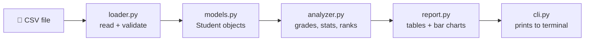

<div align="center">

# 🎓 Student Performance Analyzer

**Turn a messy marks spreadsheet into clear answers, right from your terminal.**

[](https://github.com/YOUR-USERNAME/student-performance-analyzer/actions/workflows/tests.yml)


[Features](#-features) · [Demo](#-demo) · [Quick start](#-quick-start) · [Usage](#-usage) · [How it works](#-how-it-works) · [Testing](#-testing) · [Roadmap](#-roadmap)

</div>

---

## ✨ Why this exists

Teachers keep marks in spreadsheets, then spend time answering the same questions by hand:

> *Who is struggling? Which subject is hardest? How does this student compare with the class?*

This tool answers each of those in **one command**, with validated input, friendly errors, and a codebase small enough to read in an afternoon.

## 🚀 Features

| | Command | What you get |
|---|---|---|
| 📊 | `summary` | Class average, top performer, and a grade distribution chart |
| 🏆 | `ranking` | Leaderboard with fair tie handling (1, 1, 3, 4) and optional `--top N` |
| 📚 | `subjects` | Mean, median, high, low, standard deviation, and top scorer per subject |
| 🪪 | `student` | Personal report card, compared against the class in every subject |
| 🚨 | `at-risk` | Students below the pass mark, with exactly which subjects |
| 📤 | `export` | Ranking saved as CSV, ready for Excel |

**Built with care:**

- 🛡️ **Strict input checking.** Bad numbers, out-of-range marks, duplicate names and missing files give errors that name the exact line.
- 🔍 **Typo-friendly.** `student Meera Nar` replies *"Did you mean: Meera Nair?"*
- 🧩 **Excel-proof.** Handles the hidden BOM, stray spaces in headers, and blank cells.
- 📦 **Zero dependencies.** Standard library only, nothing to install except Python.
- ✅ **61 tests** run on Python 3.9 to 3.13 through GitHub Actions.

## 🎬 Demo

```text
$ student-analyzer summary

STUDENT PERFORMANCE SUMMARY
===========================

Students analysed : 12
Subjects          : Math, Physics, Chemistry, English, Computer Science
Class average     : 75.5 (C)
Top performer     : Meera Nair (94.8)
Needs support     : 4 student(s) below 60 in at least one subject

Grade distribution
------------------
  A  ████████████████████  3
  B  ████████████████████  3
  C  █████████████░░░░░░░  2
  D  █████████████░░░░░░░  2
  F  █████████████░░░░░░░  2
```

<details>
<summary><b>🏆 Ranking</b> &nbsp;<code>student-analyzer ranking --top 5</code></summary>

```text
TOP 5 STUDENTS
==============

Rank  Name          Average  Grade  Best subject      Weakest subject
----  ------------  -------  -----  ----------------  ----------------
   1  Meera Nair       94.8  A      Computer Science  English
   2  Neha Gupta       90.4  A      English           Physics
   3  Aarav Sharma     90.2  A      Computer Science  English
   4  Isha Verma       88.2  B      Physics           English
   5  Sana Khan        82.2  B      English           Computer Science
```
</details>

<details>
<summary><b>📚 Subject breakdown</b> &nbsp;<code>student-analyzer subjects</code></summary>

```text
SUBJECT BREAKDOWN
=================

Subject           Mean  Median  High   Low  Std dev  Top student
----------------  ----  ------  ----  ----  -------  -----------
Math              73.0    75.5  97.0  38.0     18.4  Meera Nair
Physics           73.3    76.5  94.0  45.0     15.7  Isha Verma
Chemistry         73.7    75.0  95.0  48.0     16.4  Meera Nair
English           78.8    80.5  94.0  58.0     11.3  Neha Gupta
Computer Science  78.8    78.5  99.0  58.0     13.0  Meera Nair

Average by subject
------------------
Math              ██████████████████████░░░░░░░░  73.0
Physics           ██████████████████████░░░░░░░░  73.3
Chemistry         ██████████████████████░░░░░░░░  73.7
English           ████████████████████████░░░░░░  78.8
Computer Science  ████████████████████████░░░░░░  78.8
```
</details>

<details>
<summary><b>🪪 Student report card</b> &nbsp;<code>student-analyzer student Meera Nair</code></summary>

```text
REPORT CARD: Meera Nair
=======================

Rank     : 1 of 12
Average  : 94.8 (A)

Math              ███████████████████████░   97.0 (A)  +24.0 vs class
Physics           ██████████████████████░░   93.0 (A)  +19.7 vs class
Chemistry         ███████████████████████░   95.0 (A)  +21.3 vs class
English           ██████████████████████░░   90.0 (A)  +11.2 vs class
Computer Science  ████████████████████████   99.0 (A)  +20.2 vs class

Strongest: Computer Science
Weakest  : English
```
</details>

<details>
<summary><b>🚨 At-risk students</b> &nbsp;<code>student-analyzer at-risk</code></summary>

```text
AT-RISK STUDENTS (pass mark 60)
===============================

Name          Average  Below the pass mark in
------------  -------  ----------------------------------------------------------------------
Tanvi Desai      50.4  Math (38.0), Physics (45.0), Chemistry (50.0), English (58.0)
Kabir Singh      53.8  Math (45.0), Physics (52.0), Chemistry (48.0), Computer Science (58.0)
Vikram Joshi     61.2  Math (56.0), Chemistry (59.0)
Rohan Mehta      65.0  Physics (58.0)
```
</details>

<details>
<summary><b>💬 Friendly errors</b></summary>

```text
$ student-analyzer student Meera Nar
Error: No student called 'Meera Nar' was found. Did you mean: Meera Nair?

$ student-analyzer summary --data broken.csv
Error: Line 4: Ben's Math mark 'abc' is not a number.
```
</details>

## ⚡ Quick start

```bash
git clone https://github.com/YOUR-USERNAME/student-performance-analyzer.git
cd student-performance-analyzer

python3 -m venv .venv
source .venv/bin/activate        # Windows: .venv\Scripts\activate
pip install -e ".[dev]"

student-analyzer summary
```

Prefer not to install? Run it straight from the source folder:

```bash
PYTHONPATH=src python3 -m student_analyzer summary
```

## 🧭 Usage

```text
student-analyzer <command> [options]
```

| Command | Options | Example |
|---|---|---|
| `summary` | | `student-analyzer summary` |
| `ranking` | `-n, --top N` | `student-analyzer ranking --top 3` |
| `subjects` | | `student-analyzer subjects` |
| `student` | name (quotes optional) | `student-analyzer student Diya Patel` |
| `at-risk` | `-t, --threshold` (default 60) | `student-analyzer at-risk -t 65` |
| `export` | `-o, --output` (default report.csv) | `student-analyzer export -o out.csv` |

Every command also accepts `-d, --data path/to/marks.csv`. The default is `data/sample_students.csv`.

### 📝 Using your own data

One row per student, one column per subject. A blank cell means *no mark* and is skipped, not counted as zero.

```csv
name,Math,Physics,English
Asha,95,90,85
Ben,70,,80
```

```bash
student-analyzer summary --data my_class.csv
```

Marks must be numbers from 0 to 100, and each name must be unique.

## 🧠 How it works



Each stage has one job and only talks to the next one:

| Module | Responsibility |
|---|---|
| `loader.py` | Reads the CSV, rejects bad data with line-numbered errors |
| `models.py` | `Student` dataclass: average, best and weakest subject |
| `analyzer.py` | Pure maths: no printing, easy to test and reuse |
| `report.py` | Formats results as text and exports CSV |
| `cli.py` | `argparse` commands, exit codes, error handling |

### 🎯 Design decisions

- **Calculation and display are separate.** `analyzer.py` never prints and `report.py` never calculates, so the logic could power a web app later without changes.
- **Reports return strings.** The CLI decides where output goes, so tests can check the text directly.
- **`main()` returns an exit code** instead of calling `sys.exit()`, so the whole CLI can be tested in-process.
- **Ties share a rank** using the average rounded to the one decimal shown on screen, so rankings never contradict what you see.
- **Zero dependencies** means instant setup and nothing to keep patched.

## 📁 Project structure

```text
student-performance-analyzer/
├── src/student_analyzer/
│   ├── models.py          # Student dataclass
│   ├── loader.py          # CSV reading + validation
│   ├── analyzer.py        # grades, stats, ranking, at-risk
│   ├── report.py          # tables, bars, CSV export
│   ├── cli.py             # argparse commands
│   └── __main__.py        # python -m student_analyzer
├── tests/                 # pytest suite (unit + end-to-end)
├── data/sample_students.csv
├── docs/BUILD_GUIDE.md    # step-by-step build walkthrough
├── .github/workflows/     # CI on Python 3.9 to 3.13
└── pyproject.toml
```

## 🧪 Testing

```bash
pytest -v                                  # all 61 tests
pytest -k "tie"                            # just the ranking-tie tests
pytest --cov=student_analyzer              # coverage (pip install pytest-cov)
```

| Area | What is covered |
|---|---|
| Models | averages, best and weakest subject, empty students |
| Loader | BOM, messy headers, blank cells, bad numbers, range limits, duplicates |
| Analyzer | grade boundaries, stats, tie ranking, custom pass marks, typo suggestions |
| Reports | bars, table alignment, every report, CSV round trip |
| CLI | every command, error exit codes, argument validation |

Want a step-by-step build? Read **[docs/BUILD_GUIDE.md](docs/BUILD_GUIDE.md)**.

## 🗺️ Roadmap

- [x] Summary, ranking, subjects, report card, at-risk, export
- [x] Strict validation with line-numbered errors
- [x] CI on five Python versions
- [ ] Weighted subjects (e.g. Math counts double)
- [ ] Compare two terms to show who improved
- [ ] `--format json` output
- [ ] Optional Matplotlib charts

## 🤝 Contributing

Ideas and pull requests are welcome. Fork the repo, create a branch, add tests for your change, and make sure `pytest` passes before opening a PR.

## 📄 License

Released under the [MIT License](LICENSE).

<div align="center">

Built with Python 🐍 · If this helped you, consider giving it a ⭐

</div>
